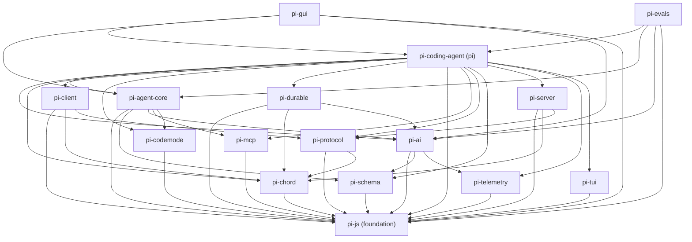

# Architecture

`pi-rs` mirrors the layered package structure of upstream Pi v1.5.2 in Cargo workspace crates, adds `pi-js` as a Rust-only JavaScript/Node compatibility foundation, and adds `pi-gui` as the Rune GPU desktop client.

## Workspace Dependency Graph

To avoid a dependency cycle between `pi-coding-agent` and `pi-gui`, running `pi gui` or `pi --gui` dispatches to the sibling `pi-gui` executable (`crates/pi-coding-agent/src/cli/args.rs` resolves `pi-gui` next to the current executable and falls back to `PATH`).

## Execution Model

- **CLI (`pi`, `pi-ai`, `pi-evals`)**: Entrypoints build a single-threaded Tokio runtime (`tokio::runtime::Builder::new_current_thread().enable_all().build()`) and drive the async entry via `block_on`, matching Node's single-event-loop interleaving across `.await` points. Library crates do not create Tokio runtimes.
- **Desktop GUI (`pi-gui`)**: Runs the Rune window loop on the main thread and delegates all `pi-coding-agent` session initialization, streaming, QuickJS extension execution, git diff collection, file scanning, and shell commands to a dedicated background Tokio worker (`GuiBridge` in `crates/pi-gui/src/bridge.rs`). UI state updates arrive asynchronously through polled events and Rune `Waker` wakeups.

## `pi-js` Runtime Foundation

`crates/pi-js` provides deterministic JS/Node semantics shared across all crates so observable output matches upstream TypeScript:

- **Insertion-ordered maps and JSON**: `pi_js::json` paired with `indexmap::{IndexMap, IndexSet}` preserves object key insertion order and JS number/float formatting (`ryu-js`).
- **UTF-16 string indices & `Intl`**: `pi_js::str16`, `pi_js::regex`, and `pi_js::intl` mirror JS `.length`/slice indexing, JS regex character classes, and `en-US` Intl collation/segmentation (`icu_segmenter`, `icu_collator`).
- **System & network APIs**: `pi_js::{path, fs, env, time, fetch, console, abort, seam}` match Node path/fs error codes (`ENOENT`, `EEXIST`, etc.), `WHATWG fetch` over `reqwest` + `rustls`, and thread-local test seams (`pi_js::seam`).
- **JSON Schema validation & coercion (`pi-schema`)**: `crates/pi-schema` implements `@earendil-works/pi-schema` (eval-free Draft 2020-12 and Draft-07 compilation, loose tool-argument coercion, and schema builders), used by `pi-ai`, `pi-agent-core`, and `pi-coding-agent` alongside `crates/pi-js/src/vendor/typebox` for QuickJS TypeBox compatibility.
- **Hand-ported npm libraries**: Byte-compatible vendor ports live directly in owning crates:
  - `crates/pi-js/src/vendor/{typebox,jsdiff}` (`typebox`, `diff`)
  - `crates/pi-ai/src/vendor/partial_json.rs` (`partial-json`)
  - `crates/pi-tui/src/vendor/{marked.rs,east_asian_width.rs}` (`marked`, `get-east-asian-width`)
  - `crates/pi-codemode/src/vendor/quickjs_wasi.rs` (`quickjs-wasi`)
  - `crates/pi-coding-agent/src/vendor/{chalk.rs,grok_mermaid.rs,proper_lockfile.rs,hosted_git_info.rs,minimatch.rs}`

## Storage & Wire Compatibility

- **Agent directory (`~/.pi/agent` or `$PI_CODING_AGENT_DIR`)**: Stores `settings.json`, `auth.json`, `models.json`, sessions JSONL, lockfiles (`proper_lockfile`), skills, prompt templates, themes, and extensions identically to upstream Pi.
- **Session files**: Append-only JSONL tree format (`session-format.md`) supporting branching, compaction entries, custom entries, and HTML export.
- **RPC & JSON modes**: `pi --mode json` and `pi --mode rpc` emit/consume the same JSONL event and command frames as upstream Pi.
- **Chord protocol**: `pi-protocol` encodes and decodes Chord CBOR frames across `pi-client` and `pi-server` Unix socket and WebSocket transports.
